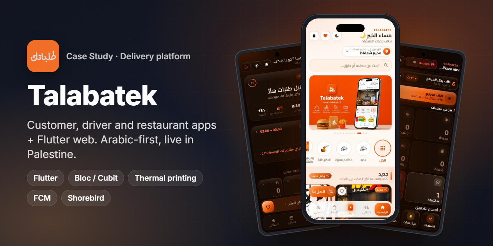
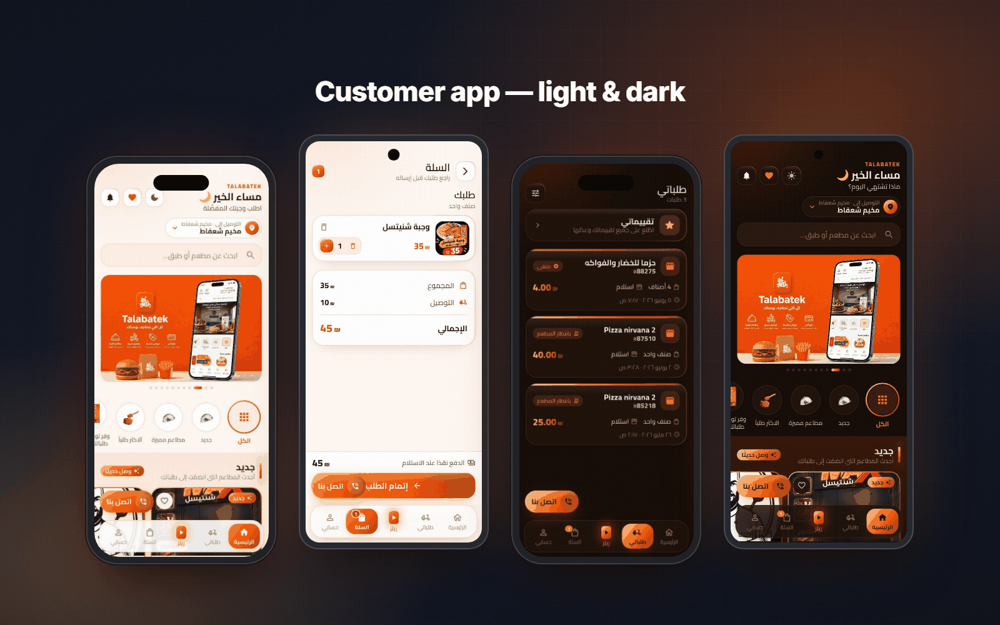
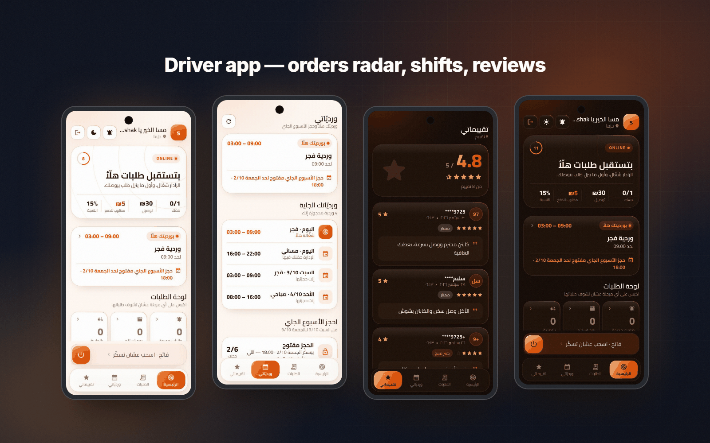
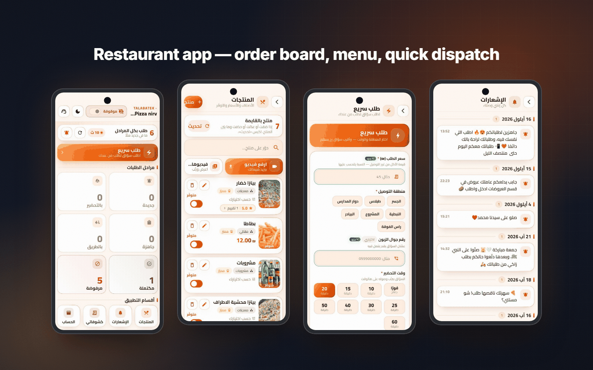
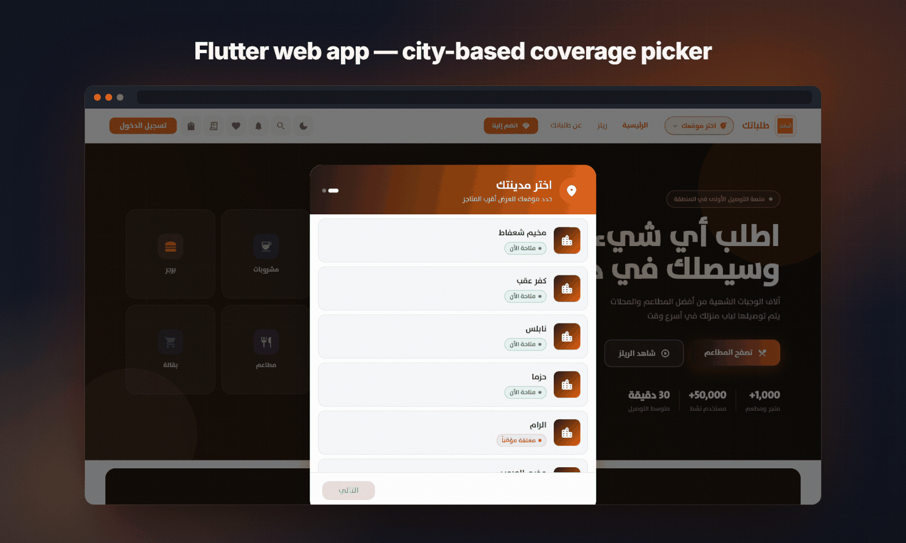
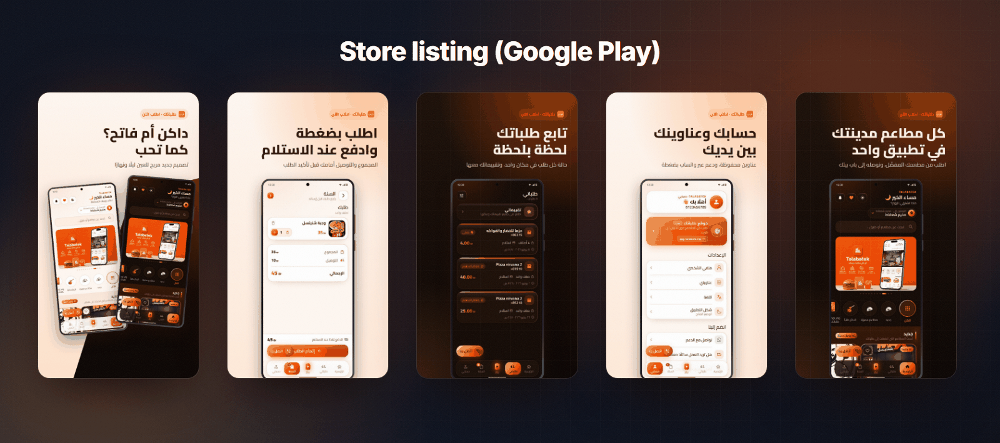
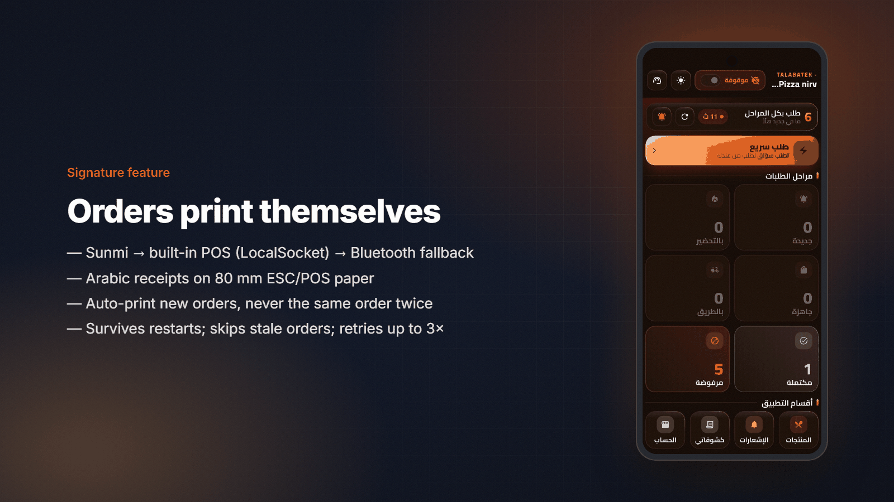
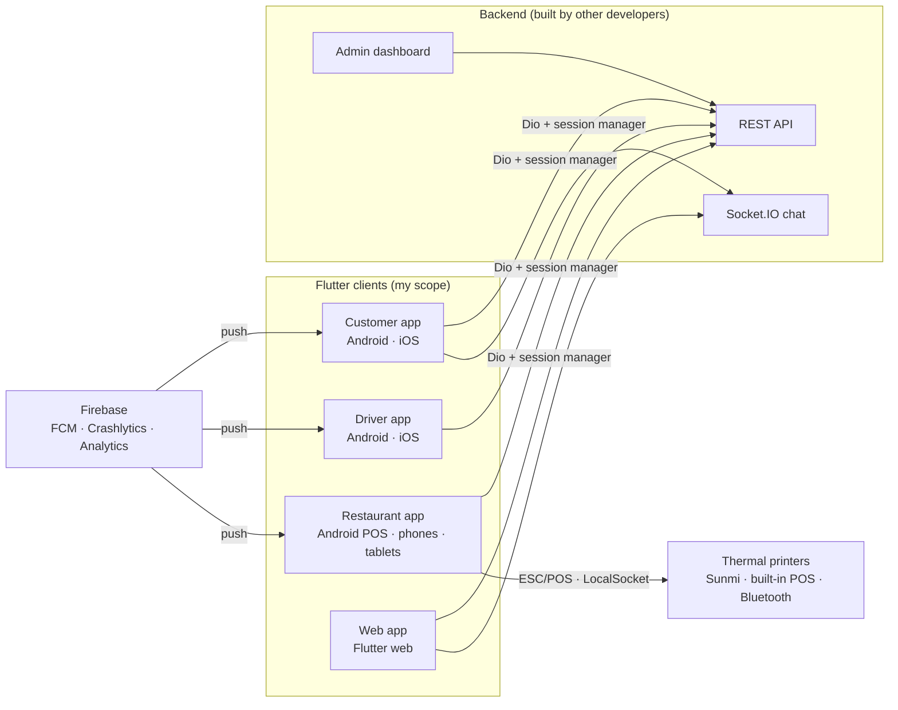

<h1 align="center">Talabatek · طلباتك</h1>

<b>A food and grocery delivery platform with four Flutter clients: customer, driver, restaurant and web. It is Arabic-first and live on Google Play and the App Store.</b>

  
  
  
  
  
  
   
  
  

> ℹ️ This is a case study. The source code belongs to the client and is not included.

## Overview

**Talabatek (طلباتك)** is a food and grocery delivery service in Palestine. It covers Shu'fat Camp, Anata, Ramallah, Kafr 'Aqab, al-Ram, Nablus and the areas around them. Customers order from restaurants, cafés and grocery stores. Drivers pick the orders up and deliver them. Restaurants manage their menus and order boards from a dedicated app.

**My role was lead Flutter engineer for every client app.** That means:

- the customer app (Android and iOS)
- the driver app
- the restaurant app, including thermal receipt printing
- the Flutter web app

I owned UI/UX implementation, app architecture, store releases and production fixes. The backend API and admin dashboard were built by other developers. I worked against their API and wrote the client-side specs and hand-off documents for them.

The customer app has been live on the App Store since January 2024. Development of all four clients continued through 2026, including a full dark/light redesign.

## The challenge

- **Three audiences, three different apps.** Customers need fast browsing and a simple checkout. Drivers need clear alerts and one-tap actions while on the move. Restaurant staff need a board that is readable from across a kitchen.
- **Real-world hardware.** Restaurants use Sunmi and other Android POS terminals with built-in printers, or Bluetooth printers. Receipts have to print in Arabic with no setup.
- **Unreliable networks and aggressive Android task-killing.** Sessions, OTP flows and order alerts have to survive process death and flaky connections.
- **City-based coverage.** The backend models cities and areas by name, not by coordinates. The phone still has to work out which area the customer is in.
- **Shipping fast without a store review every time.** Hot fixes ship over the air.

## Highlights

**🛒 Customer app**
- Browse restaurants by category, search with Arabic text normalisation, and see "new" and "free delivery" rails.
- Cart and checkout with cash on delivery, saved addresses and a map-based address picker.
- Order history, ratings and reviews, and an active-order banner that refreshes in the background.
- OTP phone login, plus Google, Apple and Facebook sign-in. Deep links (verified App Links) open shops and orders directly.
- A short-video "reels" feed, in-app chat, and light and dark themes.

**🛵 Driver app**
- An "orders radar" home screen with online/offline status and earnings counters.
- Persistent order notifications with **Accept / Reject buttons**, and critical alerts that can ring even in silent mode.
- A shift booking system (driver rotas per week) and a ratings and reviews screen.

**🍽️ Restaurant app**
- A live order board grouped by stage: new, preparing, ready, on the way, done and rejected.
- **Automatic thermal printing** of every new order. It works on Sunmi, built-in POS printers and Bluetooth printers.
- Menu management with images and per-item video, availability toggles and offers.
- A "quick order" form for requesting a driver for orders the restaurant took itself, plus statements, notifications and dark mode.

**🌐 Web app (Flutter web)**
- Ports the customer experience to the browser, with a city picker, cart and OTP login.
- Uses clean-architecture features with `go_router` and `hydrated_bloc`. It is deployed as a static build behind nginx.

## Screens

Customer app: home, cart, orders (dark) and home (dark).

Driver app: orders radar, shift booking, reviews and dark mode.

Restaurant app: order stages board, menu with availability toggles, quick driver request and notifications.

Flutter web build running locally. A first-time visitor picks their city, and the list of open and closed cities comes from the live coverage data.

## Signature feature: orders that print themselves

Restaurants don't want to tap "print" for every order. The restaurant app prints each new order automatically on whatever printer the device has.

1. **It detects the printer, in order.** First it checks for a Sunmi device, either through the Sunmi SDK binding or a native check of the device maker. Next it tries the built-in "Intelligent POS" printer. A small Java `PrinterClient` sends raw ESC/POS bytes to it over an Android **`LocalSocket`**, going through a list of known socket names. Last, it falls back to a Bluetooth printer.
2. **It formats the receipt for 80 mm paper.** Receipts are built with `esc_pos_utils_plus` and Arabic text is sent as UTF-8. On Sunmi, it uses the native right-aligned text API. The on-screen invoice preview and PDF path use an embedded Arabic font.
3. **It never prints the same order twice.**
   - The IDs of printed orders are saved across restarts, capped at 400.
   - On the first run after an update, existing orders are marked as already printed instead of all printing at once.
   - Orders older than 12 hours are skipped.
   - An order only counts as printed once the paper actually comes out. Each order gets up to 3 attempts per session.
4. **It reacts quickly.** A 15-second refresh runs while the app is open, and a push for a new order triggers a refresh right away. Order fetches are single-flight, so overlapping refreshes can't print one order twice.

## Architecture & stack

| Layer | Tech |
|---|---|
| UI | Flutter (Material 3) with custom design tokens, light and dark themes, Arabic RTL, TheSans and Tajawal fonts |
| State | `flutter_bloc` (Cubits). The restaurant app adds `get_it`, `dartz` (`Either`) and `equatable`. The web app adds `hydrated_bloc` and `go_router` |
| Networking | `dio` with a shared session manager for access and refresh tokens, and `socket_io_client` for chat |
| Maps & location | `google_maps_flutter` on Android and `flutter_map` (OpenStreetMap) on iOS and web; `geolocator` and `geocoding` |
| Notifications | Firebase Cloud Messaging and `flutter_local_notifications` (max-importance channels, action buttons) |
| Printing | `sunmi_printer_plus`, `esc_pos_utils_plus`, a native Android `LocalSocket` bridge, and `pdf`/`printing` for previews |
| Delivery | Shorebird code push for the mobile apps; Docker and nginx for the web build |
| Quality | Unit tests across the customer, driver and restaurant apps (about 80 tests), and `flutter analyze` clean across all four projects |

## Engineering notes

- **Token refresh that is safe with rotating refresh tokens.**
  - The server issues a short-lived access token and a refresh token that is replaced on every use. Reusing an old refresh token revokes the whole token family.
  - So all apps share one `SessionManager` with a static single-flight `Future`. When several requests get a 401 at once, only the first one calls the refresh endpoint and the others wait for its result.
  - The new refresh token is saved before the new access token, so a crash between the two writes can be recovered from.
  - Only a real 401 logs the user out. A 429 or 503 counts as temporary, so a backend outage doesn't sign everyone out.
- **OTP login moved to the server.** The old flow compared the code on the device. I moved verification to the server and documented the backend contract for the API team. The pending phone number is saved, never the code, so Android killing the app in the middle of OTP doesn't lose the user's place.
- **Matching a location to a city without coordinates.** The backend has no coordinates for cities, so the app reverse-geocodes the customer's location. It then fuzzy-matches the result against the city and area names. Arabic spellings are normalised, and the English names many geocoders return (for example *Shu'fat*) are mapped to their Arabic equivalents. The customer only has to confirm the suggested city and area. 13 unit tests cover this, including false-match cases.
- **Order alerts drivers can't miss.**
  - Order notifications stay on screen and have Accept and Reject actions.
  - An opt-in critical-alert mode sounds even when the phone is silent.
  - The app sends a heartbeat so the backend knows which drivers are actually online.
  - Order polling is single-flight to avoid stale data.
- **One codebase per audience, kept in step.** Shared Arabic UX patterns and design tokens (`TkDesign`) let the dark v2 redesign roll out across the customer, driver and restaurant apps in the same release cycle. I wrote a port plan to bring later customer-app changes to the web app.

## Results

- **Customer app:** 10K+ installs on Google Play ([com.talabatek.app](https://play.google.com/store/apps/details?id=com.talabatek.app)). On the App Store since January 2024.
- **Driver app:** 100+ installs on Google Play ([com.talabatek.delivery](https://play.google.com/store/apps/details?id=com.talabatek.delivery)).
- **Restaurant app:** 100+ installs on Google Play ([com.talabatek.restaurant](https://play.google.com/store/apps/details?id=com.talabatek.restaurant)), and on the [App Store](https://apps.apple.com/sa/app/talabatek-restaurants/id6740852149).
- **4 Flutter clients** shipped from one team. The same platform was later redeployed for two more brands (see below).

## Part of a white-label platform

The same platform was redeployed for three brands, each with its own identity:

| Repo | Brand | What it shows |
|---|---|---|
| **[talabatek-case-study](https://github.com/ANaSHaker/talabatek-case-study)** | Talabatek (this repo) | The original food and grocery delivery platform: customer, driver, restaurant and web apps |
| [oneway-case-study](https://github.com/ANaSHaker/oneway-case-study) | OneWay Fast Food | A white-label redeployment with a new brand kit, golden tests and adaptive live driver location |
| [gahez-case-study](https://github.com/ANaSHaker/gahez-case-study) | Jahiz · جاهز | The same foundations reshaped into a home-services marketplace with customer and worker apps |

## بالعربي

**طلباتك** منصة توصيل طعام وبقالة في فلسطين، تتكوّن من أربعة تطبيقات Flutter: تطبيق العميل، وتطبيق السائق، وتطبيق المطعم، وتطبيق الويب.
دوري: مطوّر Flutter رئيسي لكل تطبيقات العملاء، من الواجهات والمعمارية حتى النشر على المتاجر وإصلاحات الإنتاج. الـ API ولوحة التحكم بناهم مطوّرون آخرون.
أبرز ما يميّزها: طباعة فواتير عربية تلقائيًا على طابعات Sunmi وطابعات POS المدمجة (عبر LocalSocket) والبلوتوث، دون أن يُطبع الطلب مرتين.
وتجديد آمن للتوكن مع تدوير الـ refresh token، وتسجيل دخول برمز OTP يتحقق منه السيرفر، ومطابقة موقع العميل بالمدينة والمنطقة بالعربي والإنجليزي.
تطبيق العميل تجاوز 10 آلاف تثبيت على Google Play، وأُعيد نشر المنصة لعلامتين تجاريتين أخريين.

## Links

- Google Play: [Customer](https://play.google.com/store/apps/details?id=com.talabatek.app) · [Driver](https://play.google.com/store/apps/details?id=com.talabatek.delivery) · [Restaurant](https://play.google.com/store/apps/details?id=com.talabatek.restaurant)
- App Store: [Customer](https://apps.apple.com/sa/app/talabatek/id6472499352) · [Restaurant](https://apps.apple.com/sa/app/talabatek-restaurants/id6740852149)

---
<h3 align="center">Built by Mahmoud Shaker — Senior Flutter Engineer</h3>

  
  
  
  
  
  
  

